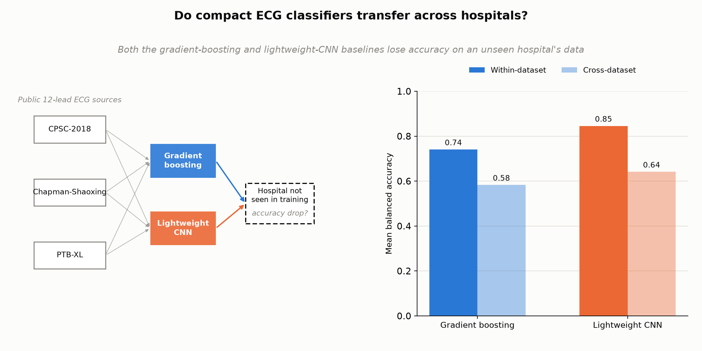
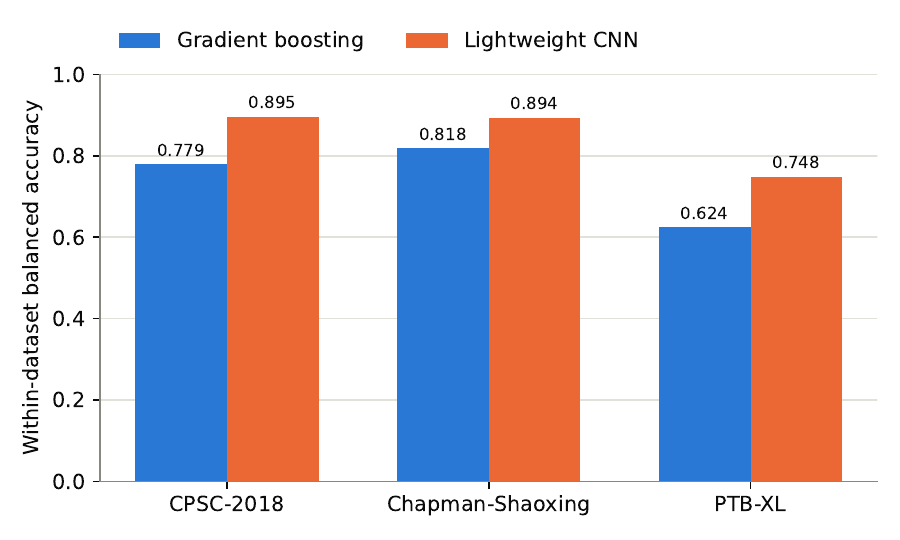
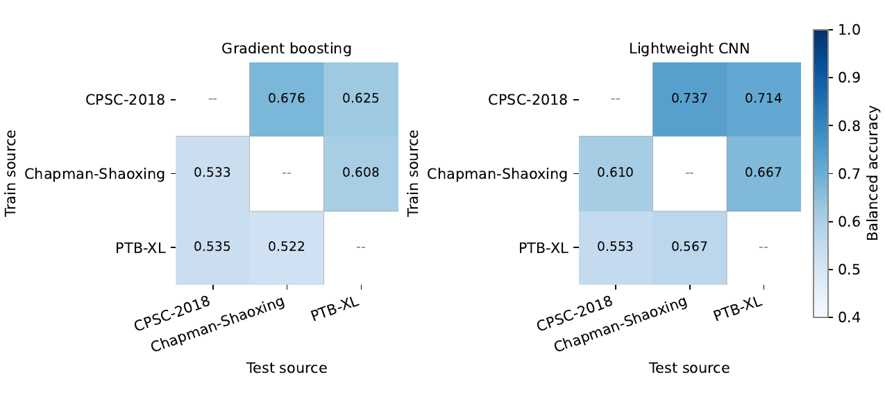

# Do Compact ECG Classifiers Transfer Across Hospitals?

Code for the cross-dataset study of lightweight 1D CNNs and gradient
boosting on public 12-lead ECG data (manuscript submitted to IEEE JBHI).

**Author:** Sarowar Alam ([ORCID 0009-0004-1004-6640](https://orcid.org/0009-0004-1004-6640))

## Summary

We train a gradient-boosting model (handcrafted ECG features + LightGBM)
and a lightweight 1D CNN (a scaled-down [LightX3ECG](https://github.com/lhkhiem28/LightX3ECG),
355,521 parameters, CPU-trainable) on three public 12-lead ECG databases —
PTB-XL, CPSC-2018, and Chapman-Shaoxing — relabelled onto a shared 5-class
scheme (AF, IAVB, LBBB, NSR, PAC) via the PhysioNet/CinC Challenge 2021
SNOMED-CT repackaging. Each model is trained on one database and evaluated
on the other two, to measure whether a classifier that performs well
within one hospital's data transfers to another's.

**Both models show the same pattern: every cross-dataset pair scores lower
than the matching within-dataset number.** The CNN outperforms the GBM
baseline on every one of the 9 comparable within- and cross-dataset
numbers, but the cross-hospital accuracy drop persists for both model
families, and PTB-XL is the hardest source to generalize to or from for
either model.

### Within-dataset balanced accuracy

| Dataset | GBM (5-fold CV) | CNN (80/20 split) |
|---|---|---|
| CPSC-2018 | 0.779 | 0.895 |
| Chapman-Shaoxing | 0.818 | 0.894 |
| PTB-XL | 0.624 | 0.748 |

### Cross-dataset balanced accuracy (train on row, test on column)

**Gradient boosting:**

| train \ test | CPSC-2018 | Chapman-Shaoxing | PTB-XL |
|---|---|---|---|
| CPSC-2018 | — | 0.676 | 0.625 |
| Chapman-Shaoxing | 0.533 | — | 0.608 |
| PTB-XL | 0.535 | 0.522 | — |

**CNN:**

| train \ test | CPSC-2018 | Chapman-Shaoxing | PTB-XL |
|---|---|---|---|
| CPSC-2018 | — | 0.737 | 0.714 |
| Chapman-Shaoxing | 0.610 | — | 0.667 |
| PTB-XL | 0.553 | 0.567 | — |

### Figures



| Within-dataset accuracy | Cross-dataset accuracy |
|---|---|
|  |  |

## Repository layout

```
code/
  download_data.py        # downloads PTB-XL, CPSC-2018, Chapman-Shaoxing headers + signals from PhysioNet
  labels.py                # SNOMED-CT -> 5-class label assignment (Challenge 2021 scheme)
  ecg_io.py                 # WFDB .hea/.mat record parsing
  features.py                # handcrafted per-lead statistics + Pan-Tompkins HRV features
  common.py                 # seeding, CSV logging, checkpointing, machine_info()
  cnn_model.py               # scaled-down LightX3ECG architecture
  train_gbm_baseline.py       # LightGBM baseline: train + 5-fold CV + cross-dataset eval
  train_cnn_baseline.py       # CNN baseline: train + 80/20 split + cross-dataset eval
  make_figures.py              # within/cross-dataset accuracy bar charts from metrics.json
  make_graphical_abstract.py    # graphical abstract figure
figures/                        # rendered output figures (PNG)
```

## Data

All three datasets are public, downloaded from PhysioNet's repackaging for
the [PhysioNet/CinC Challenge 2021](https://physionet.org/content/challenge-2021/1.0.3/)
(Reyna et al. 2021, dataset DOI [10.13026/34va-7q14](https://doi.org/10.13026/34va-7q14)),
which gives all three sources a shared SNOMED-CT `#Dx` label field:

- **PTB-XL** — Wagner et al. 2020, DOI [10.1038/s41597-020-0495-6](https://doi.org/10.1038/s41597-020-0495-6)
- **CPSC-2018** — Liu et al. 2018, DOI [10.1166/jmihi.2018.2442](https://doi.org/10.1166/jmihi.2018.2442)
- **Chapman-Shaoxing** — Zheng et al. 2020, DOI [10.1038/s41597-020-0386-x](https://doi.org/10.1038/s41597-020-0386-x)

No raw data is included in this repository. `code/download_data.py`
downloads it directly from PhysioNet over HTTPS (no credentials required;
these are open-access databases).

## Setup

```bash
python -m venv .venv
source .venv/bin/activate   # .venv\Scripts\activate on Windows
pip install -r requirements.txt
# torch is listed as the CPU build; on a machine with a CUDA GPU, torch will
# still work, but everything here was developed and timed on CPU only.
```

## Reproducing the results

Run from the repository root:

```bash
# 1. Build the label index (downloads .hea headers for ~39,000 records)
python code/download_data.py headers
python code/download_data.py build-index

# 2. Download signals for a class-balanced capped subset (~7,000 records)
python code/download_data.py signals --cap-per-class 800

# 3. Train and evaluate both baselines
python code/train_gbm_baseline.py
python code/train_cnn_baseline.py

# 4. Regenerate the figures from the resulting metrics.json files
python code/make_figures.py
python code/make_graphical_abstract.py
```

Each training script writes `metrics.json` plus CSV logs to its own run
folder, following the convention: within-dataset results come from
training and testing on the same source; cross-dataset results come from
training on one source and testing on each of the other two, unchanged.

Step 2 (signal download) took about 72 minutes on a residential connection
(PhysioNet does not offer a bulk zip for this directory layout). Step 3
takes under a minute for the GBM baseline and about 23 minutes for the CNN
baseline, both on an 8-core CPU laptop with no GPU.

## Citation

If you use this code, please cite the dataset papers above and (once
published) the accompanying manuscript. A full citation will be added here
after acceptance.

## License

MIT (see `LICENSE`).
